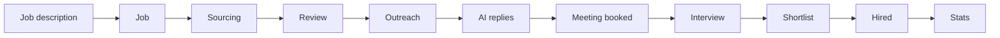
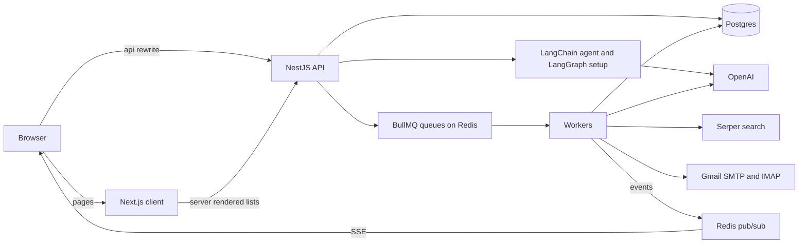
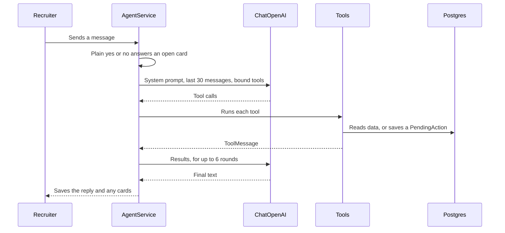
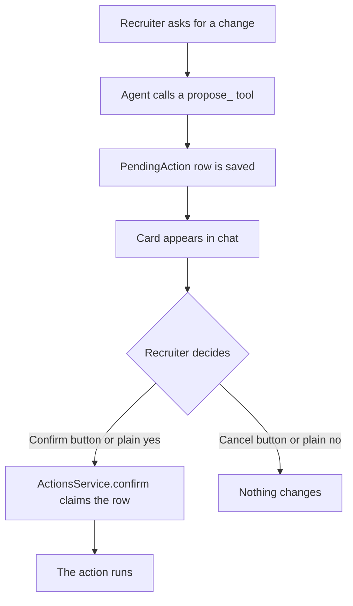
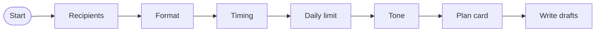

# HireFlow AI

A chat-first AI recruiting co-worker that runs a recruiter's whole hiring process, from job description to hire. Built for the Aironauts AI Engineer technical assignment.

The recruiter works mainly by talking to the AI. The chat shows interactive cards, not just text. Heavy work runs in background jobs, and every result is saved under the job. Nothing is written or sent until the recruiter confirms it.



## Contents

- [Features](#features)
- [Tech stack](#tech-stack)
- [Run it](#run-it)
- [Try the full flow](#try-the-full-flow)
- [Architecture](#architecture)
- [Feature flow, step by step](#feature-flow-step-by-step)
- [The LangChain agent](#the-langchain-agent)
- [Human in the loop](#human-in-the-loop)
- [Background jobs](#background-jobs)
- [Email](#email)
- [AI safety](#ai-safety)
- [API reference](#api-reference)
- [Why this LLM and agent approach](#why-this-llm-and-agent-approach)
- [What is done, mocked and skipped](#what-is-done-mocked-and-skipped)
- [Trade-offs](#trade-offs)

## Features

- **Chat with interactive cards:** job confirmation, candidate table, email previews, status changes and approvals.
- **LangChain agent with 23 tools:** create jobs, source, accept or reject, run campaigns, reply, update statuses and answer questions about the pipeline.
- **Human in the loop:** every write or send needs the recruiter's confirmation, enforced in code. Campaign setup is a LangGraph flow with button suggestions.
- **Sourcing:** web search with Serper, or a CSV upload with column matching, then duplicate removal and AI scoring from 0 to 100.
- **Outreach:** single emails or sequences, personal AI drafts, a daily limit, and pause, resume and stop.
- **AI replies:** real replies read from Gmail or a simulate button, then classified and answered with a draft for approval.
- **Meetings:** the recruiter picks any future time and sends a calendar invite, or the candidate picks from a booking link.
- **Pipeline:** status changes from chat or the UI, all saved to the activity log.
- **Stats:** a dashboard with the funnel, reply rate, interested rate, meetings and hires per job.
- **Paged lists:** Jobs, Candidates, Campaigns, Meetings and Activity, with server-side pagination, search and filters.
- **Optional extras:** auto-reply with safety rules, token and cost tracking per job, and prompt injection protection.

## Tech stack

| Part | Choice |
| --- | --- |
| Backend | NestJS 11 (on Express), TypeScript |
| Frontend | Next.js 16, React 19, TypeScript, Tailwind CSS 4 |
| Database | PostgreSQL with Prisma 7 |
| Background jobs | BullMQ on Redis |
| AI | OpenAI `gpt-4o-mini`, LangChain tool calling, LangGraph |
| Live updates | Server-Sent Events, through Redis pub/sub |
| Search | Serper |
| Email | Nodemailer for sending, ImapFlow for reading |

This differs from the brief in three ways. Postgres and Prisma replace MongoDB, as agreed with HR. NestJS and Next.js replace plain Express and React 18. Both apps live in one repository, so one command runs everything.

## Run it

You need your own OpenAI and Serper keys. Everything else is optional.

### With Docker

```bash
cp backend/.env.example backend/.env
```

Fill in `OPEN_AI_API_KEY`, `SERPER_API_KEY`, `JWT_SECRET`, `JWT_REFRESH_SECRET` and `ADMIN_PASSWORD`, then:

```bash
docker compose up --build
```

This one command starts Postgres, Redis with the BullMQ queues, the backend and the client. Migrations and the admin seed run when the backend starts.

Open <http://localhost:3000> and sign in with `ADMIN_EMAIL` and `ADMIN_PASSWORD`. Set `CLIENT_PORT` to use a different port.

### Your data

Database and queue data are saved in a `data/` folder in this project, so they're still there after `docker compose down` or a restart. The folder isn't committed to git.

To start again with an empty database, stop the app and delete the folder. Docker creates its files as another user, so this needs `sudo`:

```bash
docker compose down
```

```bash
sudo rm -rf data
```

### Without Docker

You need Node 22, Postgres and Redis running.

Start the backend, which listens on port 5000:

```bash
cd backend
cp .env.example .env
npm install
npx prisma migrate deploy
npx prisma generate
npm run seed
npm run start:dev
```

Then, in a second terminal, start the client on port 3000:

```bash
cd client
cp .env.example .env
npm install
npm run dev
```

### Settings

All of these are in `backend/.env.example`. The client has one setting, `BACKEND_URL`.

| Setting | What it does |
| --- | --- |
| `OPEN_AI_API_KEY`, `OPEN_AI_MODEL` | The LLM key and model |
| `SERPER_API_KEY` | Web search for candidates |
| `LLM_INPUT_USD_PER_MILLION`, `LLM_OUTPUT_USD_PER_MILLION` | Prices for the cost shown on the Jobs page. Set these when you change the model. |
| `DATABASE_URL` | Postgres connection |
| `REDIS_HOST`, `REDIS_PORT`, `REDIS_PASSWORD`, `REDIS_DB`, `REDIS_KEY_PREFIX` | Redis connection |
| `JWT_SECRET`, `JWT_REFRESH_SECRET` | Session signing |
| `ADMIN_NAME`, `ADMIN_EMAIL`, `ADMIN_PASSWORD` | The account the seed creates |
| `SMTP_HOST`, `SMTP_PORT`, `SMTP_USER`, `SMTP_PASS`, `SMTP_FROM` | Sending email. Leave `SMTP_USER` or `SMTP_PASS` empty to use a free test inbox. |
| `IMAP_HOST`, `IMAP_PORT` | Reading candidate replies from the same account |
| `OUTREACH_DAY_SECONDS` | Seconds in an outreach "day". `86400` is real time, and `20` shows follow-ups quickly in a demo. |
| `APP_URL` | The public address of the client, used in booking links |
| `PORT`, `NODE_ENV`, `CORS_ORIGIN` | Server settings |

For Gmail, `SMTP_USER` is your address and `SMTP_PASS` is an [app password](https://myaccount.google.com/apppasswords), which needs 2-Step Verification turned on.

## Try the full flow

Sample data is in `backend/prisma/sample-data/`.

1. Paste `sample-job-description.txt` into the chat, review the card and confirm the job.
2. Confirm the web search, or upload `sample-candidates.csv`. The file includes a duplicate and a row with no contact details, to show both being handled.
3. Say "accept the top 3", then confirm the card.
4. Say "set up outreach" and answer the questions with the buttons.
5. Review and edit the drafts, then approve them. Set `OUTREACH_DAY_SECONDS=20` to see follow-ups go out in seconds.
6. Reply to the email from the candidate's inbox, or use **Simulate reply** on a sent email.
7. If they asked to meet, pick a date and time on the reply card, then press **Approve and send**.
8. Say "mark Ayesha as interviewed", then shortlisted, then hired, and confirm each card. You can also use the control on the Candidates or Meetings page.
9. Ask "how is the job going?", then open the dashboard.

## Architecture



The browser only talks to the client's address. `/api` rewrites to the backend, which keeps session cookies first-party. Sessions use a 15-minute access token and a 7-day refresh token, and every token is checked against the database.

### Backend folders

| Folder | What it holds |
| --- | --- |
| `src/chat` | The agent, tools, confirmation gate, candidates, status rules and SSE |
| `src/campaign-setup` | The LangGraph human-in-the-loop setup for outreach |
| `src/sourcing` | Serper search, CSV column matching, duplicate removal and scoring |
| `src/outreach` | Drafting, the send dispatcher, email and calendar invites |
| `src/replies` | The Gmail inbox reader, classification, drafts and auto-reply rules |
| `src/meetings` | Meeting times, booking links and the meetings list |
| `src/jobs`, `src/dashboard` | The jobs list, funnel, stats and AI usage |
| `src/llm` | The model clients, usage recording and untrusted text handling |
| `src/common` | Shared pagination |

### Client pages

| Route | What it does |
| --- | --- |
| `/chat` | The main workspace, with cards and live progress |
| `/` | Dashboard |
| `/jobs`, `/candidates`, `/campaigns`, `/meetings`, `/activity` | Paged lists with search and filters |
| `/book/[token]` | Public booking page for candidates |
| `/login` | Sign in |

### Data model

There are 22 tables and no JSON columns.

- **Chat:** `Conversation`, `Message`. A card is stored as a type plus foreign keys, and the UI rebuilds it from the live rows, so a card always shows current data.
- **Jobs:** `JobDraft` holds what the AI extracted. `Job` only exists after the recruiter confirms.
- **Candidates:** `SourcingRun`, `Candidate`, `ActivityLog`.
- **Confirmation:** `PendingAction`, `PendingActionCandidate`.
- **Outreach:** `Campaign`, `CampaignStep`, `CampaignRecipient`, `OutboundEmail`.
- **Replies and meetings:** `CandidateReply`, `Meeting`.
- **LangGraph:** `AgentQuestion`, `AgentQuestionOption`, `AgentCheckpoint`, `AgentCheckpointWrite`.
- **Tracking:** `LlmUsage`, with one row per AI call.
- **Accounts:** `User`, `UserToken`.

## Feature flow, step by step

### 1. Start

A new chat opens with a greeting that asks for a job description, pasted or as a link.

### 2. Create the job

1. The agent reads a link with `read_job_posting` if there is one, then calls `propose_job`.
2. It extracts the title, must-have and nice-to-have skills, seniority, location, salary and remote policy. Anything the text doesn't say stays empty.
3. An editable card appears. No job exists yet.
4. Confirming creates the job, and the AI offers to start sourcing.

### 3. Sourcing

1. The recruiter confirms the search card, or uploads a CSV.
2. **Search:** Serper runs a `site:linkedin.com/in` query built from the title, skills and location. LinkedIn itself is never scraped.
3. **CSV:** the recruiter matches the file's columns in a dialog, so any format works.
4. Duplicates are removed by email or profile URL, using unique database indexes.
5. Candidates are scored from 0 to 100 with a short reason.
6. Live progress appears in the chat, such as "Found 23, scored 15".

### 4. Review

The candidate table shows the score, reason and profile link. The recruiter accepts or rejects with buttons, or by chat ("accept the top 5"). Every decision is saved under the job.

### 5. Outreach

1. The recruiter asks for outreach, and the [LangGraph setup](#2-campaign-setup-with-langgraph) asks each decision with buttons.
2. Confirming the plan starts a background job that writes personal drafts.
3. The recruiter edits the drafts and approves them. Nothing is sent before this.
4. Sending runs in the background, within the daily limit.

Only accepted candidates with an email can be added. Someone already in a live campaign, or already emailed, is left out. From chat, a campaign can be paused, resumed, stopped or given a new limit, for example "resume at 50 a day".

### 6. AI replies

1. A reply arrives from Gmail or the **Simulate reply** button.
2. Follow-ups stop straight away, before any AI runs.
3. A background job classifies the reply, updates the status and drafts a response.

| Classification | New status | Next step |
| --- | --- | --- |
| Interested | Interested | Drafts a reply |
| Wants a meeting | Interested | Drafts a reply and prepares a meeting |
| Question | Replied | Drafts an answer from the job's facts, or says the recruiter will check |
| Not interested | Not interested | Drafts a short thank-you |
| Unsubscribe | Unsubscribed | Sends nothing and cancels any meeting |

A later reply never moves someone backwards, except for an unsubscribe. The draft waits on its card for approval, unless [auto-reply](#auto-reply) is on and every safety rule passes.

### 7. Meeting booked

The reply card has a date and time picker with two paths:

- **The recruiter picks a time:** any future time. The draft rewrites itself to state that time, and the email carries a real calendar invite. The candidate moves to Meeting booked once it's sent.
- **The recruiter leaves it empty:** a private booking link is added to the email, and the candidate picks a time on the public page.

The **Meetings** button on each job opens that job's meetings. The Meetings page lists everything with search and filters.

### 8. Interview, shortlist, hire

The recruiter updates statuses from the UI, or by chat ("mark Rahim as hired"). The rules live in one place, `src/chat/candidate-status.ts`, so the UI and chat can't disagree. Every change goes in the activity log.

Sourced → Accepted / Rejected → Contacted → Replied → Interested / Not interested → Meeting booked → Interviewed → Shortlisted → Hired / Rejected.

Unsubscribed can happen at any point after Contacted, and it stops all outreach.

### 9. Stats

The dashboard shows the funnel, reply rate, interested rate, meetings and hires per job. The recruiter can also ask in chat ("how is the React job going?") for a summary from the same numbers.

## The LangChain agent

The agent is a tool-calling loop in `src/chat/agent.service.ts`. Its tools are in `src/chat/agent-tools.service.ts`.



### How the tools are built

- Each tool uses LangChain's `tool()` with a zod schema.
- Tools are built fresh for each turn, so they can see that turn's chat and recruiter.
- `ChatOpenAI` binds them with `bindTools(tools, { strict: true })`, so every call matches its schema.
- A failed tool goes back to the model as a `ToolMessage`, so it can explain or try another way.
- Each call records its token usage against the job.

### Naming convention

Tools are snake_case `verb_noun`, and the first word says what a tool may do. None of them can write directly.

| Prefix | Meaning |
| --- | --- |
| `read_`, `list_`, `get_` | Only looks at data |
| `propose_` | Only shows a card, and nothing happens until the recruiter confirms |
| `start_` | Hands the turn to a guided flow |

### All 23 tools

| Tool | What it does |
| --- | --- |
| **Jobs** | |
| `read_job_posting` | Reads a job posting from a public link |
| `propose_job` | Shows an editable job draft |
| `propose_job_update` | Shows an editable card with changes to the job |
| `list_jobs` | Lists the recruiter's jobs |
| `get_job_details` | Gets a job's saved details |
| `get_job_stats` | Gets real progress numbers for a job |
| `propose_auto_reply_change` | Asks to turn auto-reply on or off |
| **Candidates** | |
| `propose_sourcing` | Asks to start a web search |
| `propose_candidate_scoring` | Asks to score candidates left unscored by a failed run |
| `list_candidates` | Lists candidates, highest score first |
| `get_candidate_details` | Looks up one person's status, score, reply and meeting |
| `propose_candidate_decision` | Asks to accept or reject candidates |
| `propose_candidate_status_change` | Asks to move a candidate to a new stage |
| **Campaigns** | |
| `start_campaign_setup` | Starts the guided setup for a new campaign |
| `list_campaigns` | Lists campaigns and their progress |
| `get_campaign_details` | Shows who is in a campaign and each email's status |
| `propose_campaign_send` | Asks to approve drafts and start sending |
| `propose_campaign_change` | Asks to pause, resume, stop or change the daily limit |
| **Replies and meetings** | |
| `list_replies` | Lists replies with their classification and drafts |
| `propose_reply_send` | Asks to send a drafted response, with an optional rewrite |
| `list_meetings` | Lists meetings, soonest first |
| **Overview** | |
| `list_activity` | Lists recent changes from the activity log |
| `list_pending_approvals` | Lists everything waiting for the recruiter |

Scoring has no tool of its own in the normal flow, because every sourcing run scores its candidates in the background.

### Stop button

While the AI works, the Send button becomes Stop. It aborts the model call on the server through an `AbortSignal`. Any card created in that turn is cancelled, so an unseen card can't catch a later "yes". The chat then says nothing was changed.

### Hiring only

The agent only helps with hiring work. For anything else, it replies that it can only help with hiring here, and it calls no tools.

## Human in the loop

The brief requires confirmation before any write or send. This app enforces that in three layers, in code rather than only in a prompt.

### 1. The confirmation gate



- A `propose_` tool never writes. It only saves a `PendingAction` and shows a card.
- The agent has no tool that reaches `ActionsService.confirm`. Only the recruiter's button or answer does.
- A plain "yes" or "no" in chat is decided by a regular expression **before the model is called**. Text inside a job post or candidate profile can't approve anything.
- Only plain answers count. "ok but change the salary" goes to the model instead of confirming a card.
- Each action is claimed atomically, so a double click can't run it twice.
- A new proposal replaces an open one of the same type, so "yes" always points at the newest card.

### 2. Campaign setup with LangGraph

Setting up a campaign takes several decisions over several messages, and that progress has to survive a restart. This is a LangGraph `StateGraph` in `src/campaign-setup/campaign-setup.graph.ts`.



1. Each node pauses with LangGraph's `interrupt()` and returns a question.
2. The question is saved as `AgentQuestion` and `AgentQuestionOption` rows, then shown with **button suggestions**. A recommended option is marked.
3. The recruiter clicks a button or types an answer.
4. The graph continues with `Command({ resume })` from the same point.
5. Anything the recruiter already stated, such as "50 a day", skips its question.
6. Typed answers are read by a LangChain structured model, and code checks the value before it's used.
7. When every answer is in, a plan card asks for final confirmation. Nothing has been written yet.

Checkpoints live in Postgres as bytes, through a custom `PrismaCheckpointSaver`. The official saver needs JSONB, and this project doesn't use JSON columns. A paused setup survives a server restart, and each question can only be answered once.

LangChain's `humanInTheLoopMiddleware` isn't used, because it pauses on tool calls. This flow needs guided questions with button choices, which `interrupt()` handles directly.

### 3. Approving what goes out

| What | How it's approved |
| --- | --- |
| Campaign drafts | Previewed, edited and approved on the review card, or with `propose_campaign_send` |
| Reply drafts | Edited and approved on the reply's card, or with `propose_reply_send` |
| Meeting times | Set on the reply card and sent only when approved |

A reply's own card isn't answered by a chat "yes", because several can be open at once and "yes" could send the wrong one. `propose_reply_send` shows a separate card naming one candidate, with the exact text.

### Auto-reply

Auto-reply is the one exception, and it's the recruiter's choice. It's off by default, set per job, and every change is logged. With it on, a reply is only sent without approval if all of these hold, checked in `src/replies/auto-reply.ts` and `replies.service.ts`:

- It was classified as Interested, Wants a meeting or Not interested. Questions always go to the recruiter.
- The model didn't flag it for a recruiter, for example for a complaint or a question about money.
- The reply doesn't look like an attempt to steer the AI.
- The draft has no link, email address, price or number of three or more digits.
- The candidate hasn't reached a meeting or a later stage.
- This candidate hasn't had an auto-reply before, so two mail robots can't answer each other forever.
- The job has sent fewer than 20 in the last 24 hours.

Anything else waits for approval as usual.

## Background jobs

All heavy work runs in BullMQ, with three attempts and exponential backoff. Workers run in the same service as the API.

| Queue | Jobs | Notes |
| --- | --- | --- |
| `sourcing` | Search | Reads 3 pages of results and saves them. Duplicates are skipped by the unique indexes. |
| `scoring` | Score | Scores in batches of 8. A retry only picks up unscored rows, so nothing is paid for twice. |
| `outreach` | `draft`, `dispatch`, `send` | `dispatch` runs every 5 seconds and queues whatever is due within the daily limit. `send` runs 3 at a time. |
| `replies` | `read`, `send`, `inbox` | `inbox` checks Gmail every minute when an account is set. |

Follow-ups aren't held in the queue for days. Each email's due date is saved in Postgres, and `dispatch` finds what's due, so scheduled emails survive a restart.

Nobody can receive the same step twice. A unique constraint on step and candidate stops a duplicate row, and each send claims its row atomically before contacting the mail server. Status is checked again at send time, because a candidate can reject or unsubscribe after drafts are approved.

Progress reaches the chat over SSE. Events go through Redis pub/sub, so they work across processes. If a job fails after its retries, the chat says so.

## Email

**Sending** uses Nodemailer. With `SMTP_USER` and `SMTP_PASS` set, email goes through your real account. Without them, it goes to a throwaway [Ethereal](https://ethereal.email) inbox with a preview link, so nothing reaches real people by accident. Every email has an unsubscribe footer.

**Reading replies** uses ImapFlow, every minute, on the same account. It reads message headers from the last 3 days, and only opens emails that answer one of our own messages, from the address that message was sent to. The rest of the mailbox stays unopened, nothing is marked as read, and each email is handled once. The quoted original is removed before the AI reads the reply.

**Calendar invites** are real `text/calendar` invites with Yes, No and Maybe options in mail apps that support them. Meetings last 30 minutes.

## AI safety

- **Never inventing data:** prompts allow only stated facts. Drafts can't claim a skill the candidate hasn't shown, and a draft with a placeholder such as `[Company]` fails and retries.
- **Never claiming false actions:** the agent can't say something happened unless a tool confirmed it, and it checks live data rather than old messages.
- **Scoring limits in code:** the model reports whether location, seniority and must-have skills are stated, and code caps the score at 75, 80 or 60 if not. The model alone was too generous.
- **Prompt injection:** outside text is wrapped in tags and treated as data, and our own tags are removed from it first, so it can't close its block early. The confirmation gate means a successful injection still can't send or write anything.
- **Unsubscribe:** enforced in code. Nobody is emailed after it, whatever the model returns.
- **Cost tracking:** tokens and estimated cost per job are shown on the Jobs page.

## API reference

Everything except login, refresh and the public booking routes needs a session.

| Method and path | Purpose |
| --- | --- |
| `POST /auth/login`, `/auth/refresh`, `/auth/logout` | Session |
| `GET /auth/me` | Current user |
| `GET`, `POST /chat/conversations` | List chats by cursor, or create one |
| `GET /chat/conversations/:id` | One chat with its messages |
| `POST /chat/conversations/:id/messages` | Send a message to the agent |
| `POST /chat/conversations/:id/stop` | Stop the running turn |
| `GET /chat/conversations/:id/events` | Live events over SSE |
| `POST /chat/conversations/:id/campaign-setup` | Start the guided setup |
| `POST /chat/actions/:id/confirm`, `/cancel` | Answer a card |
| `POST /chat/questions/:id/answer`, `/cancel` | Answer a setup question |
| `PATCH /chat/job-drafts/:id` | Edit a job draft |
| `GET /jobs`, `/jobs/options` | Paged jobs, and job names for filters |
| `PATCH /jobs/:id/auto-reply` | Turn auto-reply on or off |
| `GET /jobs/:id/candidates` | A job's candidates |
| `PATCH /jobs/:id/candidates/:candidateId/decision`, `/status` | Accept, reject or move a candidate |
| `POST /jobs/:id/candidates/csv/preview`, `/csv` | Match CSV columns, then import |
| `GET /candidates`, `/campaigns`, `/meetings`, `/activity` | Paged lists |
| `GET /campaigns/:id` | One campaign with its emails |
| `PATCH /campaigns/:id/emails/:emailId` | Edit a draft |
| `POST /campaigns/:id/pause`, `/resume`, `/stop` | Control a campaign |
| `POST /simulate-reply` | Simulate a candidate reply |
| `PATCH /replies/:id/draft`, `/meeting-time` | Edit a reply draft, or set a meeting time |
| `GET /meetings/public/:token`, `POST .../book` | Public booking page |
| `GET /dashboard` | Dashboard numbers |

Paged lists accept `page`, `pageSize` and `search`, plus their own filters. Chats use a cursor instead of page numbers, because a new message moves a chat to the top and would make pages skip or repeat rows.

## Why this LLM and agent approach

- **OpenAI `gpt-4o-mini`:** it's cheap enough to score every candidate, and strict JSON output means a bad response fails in validation instead of reaching the recruiter. The model is set by `OPEN_AI_MODEL`.
- **LangChain tool calling for the agent:** typed tools and strict schemas keep calls valid, and the loop stays in our code so the confirmation gate sits outside the model.
- **LangGraph only for campaign setup:** this one flow really is a long-running, multi-question conversation that has to survive a restart, which is what `interrupt()` and checkpoints are for.
- **OpenAI SDK for background AI jobs:** scoring, drafting and reply reading are single calls with strict JSON output, so they don't need an agent.

## What is done, mocked and skipped

**Done:** every core requirement in the brief. From the optional list, that includes real email sending, auto-reply with safety rules, token and cost tracking per job, pause and resume, AI job summaries in chat, and prompt injection protection.

**Mocked:**

| Service | Mock |
| --- | --- |
| Candidate inbox | Real Gmail when an account is set. Without one, `POST /simulate-reply` and a UI button take the same path. |
| Calendar | The recruiter picks any time and sends a real invite. It doesn't check a real calendar for conflicts. The booking link offers generated slots instead of Calendly. |
| Email | A throwaway Ethereal inbox until an account is set |

**Skipped:**

- Rescheduling or cancelling a meeting in the app, and telling a candidate when a meeting is cancelled
- Seeing a candidate's Yes or No on a calendar invite. That answer goes to the recruiter's inbox.
- Timezones on booking-link slots, which use the server's timezone
- Closing a job, and user sign-up. The seed creates the admin account.
- Automated tests. The flows were checked by running them against the real agent and a throwaway database.

## Trade-offs

- **One service for the API and workers:** it's simpler to run, but they can't scale separately yet. Splitting them only needs a second entry point.
- **One repository:** one command runs everything, while the brief asked for separate backend and frontend repositories. Each app stays self-contained in its own folder, with its own Dockerfile, so it can be split out.
- **Cards rebuilt from live rows:** the chat always shows the truth, but old cards change as data moves on.
- **Dashboard funnel by furthest stage:** it comes from the activity log, so someone who left still counts for the stages they reached. Exits are shown beside it.
- **Dashboard and lists refresh on load:** only the chat is live.
- **Search uses `ILIKE`:** that's fine at this size, and a larger deployment would add trigram indexes.
- **Off-topic rule in the prompt:** it isn't enforced in code, so an unusual question could occasionally get through. It still can't change anything without confirmation.
- **Inbox polled every minute:** a reply can take up to a minute to appear. Matching on the email thread means a brand-new email from a candidate isn't picked up.
- **Booking links need a public address:** set `APP_URL` when hosted. On `localhost`, the link only opens on your own computer.
- **Costs use one price per token:** set in `.env`, and only counting calls made through `LlmService`. The small reader for typed setup answers isn't counted.
- **A wrong reply label:** it can be corrected with the status control, but the AI won't re-read the reply.
